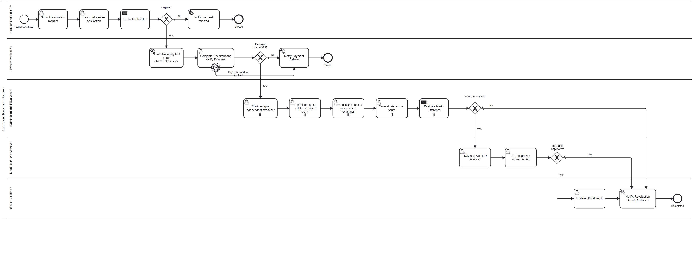
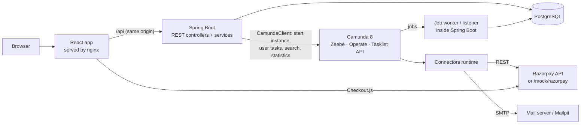

# Examination Revaluation Workflow

A full-stack workflow automation application for university **answer-script revaluation**, built with
**Camunda 8.9, Spring Boot 3.5, React 18 and PostgreSQL 16**.

A student asks for revaluation of one or more subjects; the exam cell verifies the application, and once it is
accepted and eligible the student pays the fee online. The exam cell assigns two
independent examiners to each script, the marks are compared by a decision table, any increase is reviewed by
the Head of Department and approved by the Controller of Examinations before it enters the official result, and the student gets the result by email. The exam cell monitors every request in a live
**Process View**.



---

## Contents

1. [Project overview](#1-project-overview)
2. [Technology stack](#2-technology-stack)
3. [System architecture](#3-system-architecture)
4. [Setup and execution](#4-setup-and-execution)
5. [BPMN process architecture](#5-bpmn-process-architecture)
6. [FEEL expression dictionary](#6-feel-expression-dictionary)
7. [Data contracts and variable scoping](#7-data-contracts-and-variable-scoping)
8. [REST API and roles](#8-rest-api-and-roles)
9. [Configuration and deployment](#9-configuration-and-deployment)
10. [Testing](#10-testing)
11. [Troubleshooting](#11-troubleshooting)

---

## 1. Project overview

**Problem.** Revaluation today runs on paper forms and email. Fees are hard to reconcile, examiners are
chosen by hand (sometimes the same person who marked the script), there is no deadline tracking, and
students have no idea where their request stands.

**Solution.** One BPMN-orchestrated workflow, in five lanes:

| Lane | Step | Who / what | Camunda construct |
|---|---|---|---|
| Request and Eligibility | Submit revaluation request (1–6 subjects) | Student, React form | User task, completed by the backend after validation |
| | Exam cell verifies application (accept / reject with remarks) | Exam cell clerk (group `exam-cell`) | User task |
| | Evaluate Eligibility (15-day window + the exam cell's decision) | `eligibilityDecision` DMN | Business rule task + gateway |
| | Notify: request rejected | Email connector | Outbound connector |
| Payment Processing | Create Razorpay test order | REST connector | Outbound connector |
| | Complete Checkout and Verify Payment | Student + server-side signature check | User task + **timer boundary** (payment window) + gateway |
| | Notify Payment Failure | Email connector | Outbound connector |
| Examination and Revaluation | Clerk assigns independent examiner | Exam cell | User task, **parallel multi-instance** per subject |
| | Examiner sends updated marks to clerk | First examiner, blind | User task, parallel multi-instance |
| | Clerk assigns second independent examiner | Exam cell | User task, parallel multi-instance |
| | Re-evaluate answer script | Second examiner, blind | User task, parallel multi-instance |
| | Evaluate Marks Difference | `marksComparisonDecision` DMN | Business rule task, parallel multi-instance + gateway |
| Moderation and Approval | HOD reviews mark increase (only if marks increased) | HOD of the student's department (group `hod-<dept>`) | User task + gateway |
| | CoE approves revised result | Controller of Examinations (group `coe`) | User task, final decision per subject |
| | Increase approved? | — | Gateway: Yes → update result, No → publish with original marks |
| Result Publication | Update official result (only if an increase was approved) | Exam cell | User task |
| | Notify: Revaluation Result Published | Email connector + `consolidate-results` listener | Outbound connector + execution listener |

**Roles in the demo:** student, exam cell clerk, examiner, Head of Department (HOD) and Controller of
Examinations (CoE). `dean.academics` can sign in and view requests but has no workflow task.

## 2. Technology stack

| Layer | Technology | Version | Why |
|---|---|---|---|
| Workflow engine | Camunda 8 (Zeebe, Operate, Tasklist) | 8.9.28 | BPMN/DMN execution, timers, retries, incidents, visibility |
| Connectors | Camunda REST and Email outbound connectors | 8.9.0 | Razorpay API and SMTP without custom code |
| Backend | Spring Boot, Camunda Spring Boot starter | 3.5.16 / 8.9.28 | REST API, typed `@JobWorker`, JPA |
| Database | PostgreSQL (H2 for tests) | 16 | Requests, subjects, payments, audit trail |
| Migrations | Flyway | 11 | Versioned schema + seed data |
| Frontend | React, Vite, Tailwind CSS | 18.3 / 5.4 / 3.4 | Portal, custom Tasklist, live tracker, Process View |
| Frontend libraries | TanStack Query, React Hook Form, zod, bpmn-js | 5 / 7 / 3 / 18 | Polling, dynamic array forms, validation, BPMN viewer |
| UI components | shadcn/ui (Radix UI, lucide icons, Sonner), Magic UI (Motion) | shadcn 2.3 (Tailwind 3) / Motion 11 | Accessible components; subtle animations that respect "reduce motion" |
| Payments | Razorpay (test mode) or built-in mock | — | Orders, Checkout, signature verification |
| Packaging | Docker, Docker Compose, nginx | — | Multi-stage builds, one-command start |

## 3. System architecture



**Layers in the backend** (`backend-springboot/src/main/java/edu/revaluation`):

| Package | Responsibility |
|---|---|
| `web` | REST controllers (requests, payments, tasks, Process View, lookups), global error handler (one JSON error shape with field errors) |
| `service` | Request creation, custom Tasklist logic and validation, examiner independence rules, checkout verification, live status, Process View, `CamundaGateway` (the only class that talks to Camunda) |
| `worker` | The `consolidate-results` job worker (start execution listener on the result email) |
| `domain`, `repository` | JPA entities and Spring Data repositories |
| `mock` | Razorpay Orders stand-in used when `RAZORPAY_MOCK=true` |

**Payment sequence.** The REST connector creates the order on the server; the student pays in Razorpay
Checkout; the backend checks `HMAC-SHA256(order_id|payment_id, key_secret)` (and that the order is this
request's order) and completes *Complete Checkout and Verify Payment* with `paymentSuccessful`; the
*Payment successful?* gateway branches on it.

**Frontend structure** (`frontend-react/src`): `components/ui/` holds the shadcn/ui components (added with the
shadcn CLI, `components.json`), `components/magicui/` the Magic UI components (BlurFade, NumberTicker, BorderBeam,
DotPattern, ShimmerButton, AnimatedShinyText), `components/shared.jsx` the portal's own building blocks, and
`lib/utils.js` the `cn()` class helper. Colours are shadcn CSS variables in `index.css`, built from the portal's
palette (navy `#0B2A55`, blue `#0B5394`, yellow `#FDC80A`; `brand`, `gold`, `ok`, `warn`, `pen` in `tailwind.config.js`).
Light and dark themes: `:root` and `.dark` in `index.css`; the Light / Dark / System toggle (`components/theme.jsx`)
sits in the sidebar and on the sign-in page, is remembered per browser and defaults to the OS setting.

**Database tables:** `app_user`, `exam_session`, `subject_catalog`, `revaluation_request`,
`request_subject`, `payment`, `request_event` (see `db/migration/V1__schema.sql`).

## 4. Setup and execution

### Prerequisites
Docker Desktop (or Docker Engine + Compose v2) with about 4 GB RAM free. For local development without
Docker: Java 21, Maven 3.9, Node 20.

### Option A: everything local (recommended for the demo, works offline)

```bash
cp .env.example .env          # defaults use mock Razorpay and Mailpit
docker compose --profile camunda up --build
```

| What | URL | Login |
|---|---|---|
| Revaluation Portal | http://localhost:3000 | pick a demo user, no password |
| Camunda Operate | http://localhost:8088/operate | demo / demo |
| Camunda Tasklist | http://localhost:8088/tasklist | demo / demo |
| Mailpit (emails sent by the workflow) | http://localhost:8025 | — |
| Backend health | http://localhost:8080/actuator/health | — |

The backend deploys all BPMN, DMN and form files from `bpmn-models/` when it starts.

### Option B: Camunda 8 SaaS cluster

1. In Camunda Console create a cluster (8.9) and an API client with Zeebe and Orchestration access.
2. In `.env` set `CAMUNDA_MODE=saas`, `CAMUNDA_AUTH_METHOD=oidc`, `CAMUNDA_CLUSTER_ID`, `CAMUNDA_REGION`,
   `CAMUNDA_CLIENT_ID`, `CAMUNDA_CLIENT_SECRET`.
3. SaaS connectors cannot reach your laptop, so use real Razorpay test keys: `RAZORPAY_MOCK=false`,
   `RAZORPAY_CONNECTOR_BASE_URL=https://api.razorpay.com`.
4. In Console > cluster > **Connector secrets** add `RAZORPAY_KEY_ID`, `RAZORPAY_KEY_SECRET`, `SMTP_HOST`,
   `SMTP_PORT`, `SMTP_SECURITY`, `SMTP_USERNAME`, `SMTP_PASSWORD`, `SMTP_FROM`.
5. `docker compose up --build` (no profile: Camunda runs in the cloud).

### Local development without Docker

```bash
docker compose --profile camunda up -d postgres camunda connectors mailpit
cd backend-springboot && DB_PASSWORD=change-me RAZORPAY_MOCK=true \
  RAZORPAY_CONNECTOR_BASE_URL=http://host.docker.internal:8080/mock/razorpay mvn spring-boot:run
cd frontend-react && npm install && npm run dev      # http://localhost:5173
```
(On Linux add `extra_hosts: ["host.docker.internal:host-gateway"]` to the connectors service.)

### Demo users

| Username | Role |
|---|---|
| `21CS042` | Student |
| `examcell.clerk` | Exam cell clerk (group `exam-cell`): verifies applications, assigns examiners, updates results; the only role with the Process View |
| `examiner.cs01` … `examiner.cs03` | Examiners (CSE) |
| `hod.cse`, `hod.ece` | Heads of Department (groups `hod-cse`, `hod-ece`): review mark increases of their department |
| `coe` | Controller of Examinations (group `coe`): final approval of mark increases |
| `dean.academics` | View requests only |

Exam session `MAY-2026` is inside the 15-day window; `DEC-2025` is closed (shows a DMN rejection).
Subject `CS399` has no scanned script, so the clerk must enter the physical script's ID.

## 5. BPMN process architecture

| File | Process / decision | Purpose |
|---|---|---|
| `bpmn-models/main/revaluation-process.bpmn` | `revaluationProcess` | The whole workflow: one pool, five lanes |
| `bpmn-models/decisions/eligibility-decision.dmn` | `eligibilityDecision` | Window + completeness → eligible, reason |
| `bpmn-models/decisions/marks-comparison.dmn` | `marksComparisonDecision` | Revised vs original → marksIncreased |
| `bpmn-models/forms/*.form` | 9 Camunda Forms | Fallback for Camunda Tasklist; the React app has its own forms |

### Constructs

| Construct | Where |
|---|---|
| Collaboration with lanes | `Request and Eligibility`, `Payment Processing`, `Examination and Revaluation`, `Moderation and Approval`, `Result Publication` |
| Parallel multi-instance (one per subject) | `clerkAssignExaminer`, `examinerSendsMarks`, `clerkAssignSecondExaminer`, `reEvaluateScript`, `evaluateMarksDifference` |
| Timer boundary (interrupting) | `paymentWindowExpired` on `completeCheckoutAndVerifyPayment` → *Notify Payment Failure* |
| Gateways (all with a default flow) | `eligibleGateway`, `paymentGateway`, `marksIncreasedGateway`, `increaseApprovedGateway` |
| Expression-based candidate group | `hodReviewIncrease`: `=["hod-" + lower case(department)]` |
| REST connector | `createRazorpayOrder` |
| Email connector | `notifyRejected`, `notifyPaymentFailed`, `notifyResultPublished` |
| Business rule tasks | `evaluateEligibility`, `evaluateMarksDifference` |
| Execution listener | `consolidate-results` (start) on `notifyResultPublished` |

Each examination step runs once per subject in parallel; the next step starts when every subject has finished
the current one. The *Notify* tasks are email connectors (the reference diagram draws them as user tasks;
sending real emails keeps the existing integration).

### Business rules

| Rule | Where it is enforced |
|---|---|
| One open request per student and exam session | `RequestService.create` (409 before the process starts) |
| Independent examiner: same department, never the first evaluator | `ExaminerAssignment`, checked when the clerk completes the task |
| Second examiner is neither the first evaluator nor the first examiner | `ExaminerAssignment` |
| Blind evaluation: examiners don't see the student, the original marks or the other examiner's marks | `TaskService` strips them from the task context |
| Final revised marks = average of both examiners, rounded half up | `TaskService` on *Re-evaluate answer script* |
| Missing scanned script: the clerk must enter the physical script's ID | `TaskService` on *Clerk assigns independent examiner* |
| A request covers one department, so it has one HOD | `RequestService.create` rejects subjects from another department |
| HOD and CoE decide per increased subject; a rejection needs a reason | `TaskService` on *HOD reviews mark increase* / *CoE approves revised result* |
| The CoE's decision is final: a rejected increase is `WITHHELD` and the original marks stand | `TaskService` rewrites `subjectResults` on *CoE approves revised result* |

### Failure handling

| Kind | Handling |
|---|---|
| Exam cell rejects the application, or the window has closed (DMN) | *Eligible?* No → *Notify: request rejected* (with the reason and remarks) → Closed |
| Payment signature or order mismatch | `paymentSuccessful = false` → *Payment successful?* No → *Notify Payment Failure* → Closed |
| Student doesn't pay in time | Timer boundary → *Notify Payment Failure* (unpaid wording) → Closed |
| Technical error (DB down, network, connector) | Exception → job retries (3, with backoff for connectors) → incident in Operate → fix → **Retry**; the Process View counts incidents |

### Job workers

| Job type | Kind | Reads | Writes |
|---|---|---|---|
| `consolidate-results` | Start execution listener on `notifyResultPublished` | requestId, subjectResults | Database: per-subject revised marks, outcome, status `RESULTS_READY` |

## 6. FEEL expression dictionary

| Element | Field | Expression |
|---|---|---|
| Evaluate Eligibility | input → `withinWindow` | `=today() <= date(resultPublishedOn) + duration(config.revaluationWindow)` |
| Evaluate Eligibility | input → `applicationComplete` | `=applicationComplete = true` (the exam cell's decision) |
| Evaluate Eligibility | output → `rejectionReason` | `=eligibility.reason`, plus `" Remarks: " + verificationRemarks` when the exam cell rejected the application |
| Eligible? | Yes condition | `=eligibility.eligible = true` |
| Create Razorpay test order | url | `=config.razorpayBaseUrl + "/v1/orders"` |
| Create Razorpay test order | body | `={amount: count(subjects) * feePerSubject, currency: "INR", receipt: requestId, notes: {studentId: studentId, examSession: examSession}}` |
| Create Razorpay test order | result expression | `={razorpayOrderId: response.body.id, razorpayAmount: response.body.amount, razorpayCurrency: response.body.currency, razorpayOrderStatus: response.body.status}` |
| Submit / Complete Checkout | assignee | `=studentId` |
| Payment window expired | timer duration / output | `=config.paymentWindow` / `=true` → `paymentExpired` |
| Payment successful? | Yes condition | `=paymentSuccessful = true` |
| Clerk assigns independent examiner | multi-instance | input `=subjects`, element `subject`, output `firstAssignments` ← `=context put(context put(subject, "firstExaminerId", firstExaminerId), "scriptId", scriptId)` |
| Examiner sends updated marks | assignee / due date | `=subject.firstExaminerId` / `=now() + duration(config.examinerSla)` |
| Examiner sends updated marks | multi-instance | input `=firstAssignments`, output `firstEvaluations` ← subject + `firstExaminerMarks`, `firstExaminerRemarks` |
| Clerk assigns second examiner | multi-instance | input `=firstEvaluations`, output `secondAssignments` ← subject + `secondExaminerId` |
| Re-evaluate answer script | assignee | `=subject.secondExaminerId` |
| Re-evaluate answer script | multi-instance | input `=secondAssignments`, output `evaluations` ← subject + `secondExaminerMarks`, `examinerRemarks`, `revisedMarks` |
| Evaluate Marks Difference | inputs | `=subject.originalMarks` → `originalMarks`, `=subject.revisedMarks` → `revisedMarks` |
| Evaluate Marks Difference | multi-instance output | `subjectResults` ← `{subjectCode, originalMarks, firstExaminerMarks, secondExaminerMarks, revisedMarks, markDifference, marksIncreased, outcome: if marksIncreased = true then "REVISED" else "UNCHANGED", …}` |
| Marks increased? | Yes condition | `=some r in subjectResults satisfies r.marksIncreased = true` |
| HOD reviews mark increase | candidate groups | `=["hod-" + lower case(department)]` |
| Increase approved? | Yes condition | `=some r in subjectResults satisfies r.marksIncreased = true` (after the CoE's decision) |
| Result email | body (excerpt) | `=string join(for r in subjectResults return r.subjectCode + ": " + string(r.originalMarks) + " -> " + string(r.revisedMarks) + …, "\n")` |

Each multi-instance task declares its own outputs as local `=null` input mappings (for example
`firstExaminerId`, `scriptId`), so parallel subjects never overwrite each other.

DMN input entries: `true`, `false`, `-` (any), `> originalMarks`, `<= originalMarks`.

## 7. Data contracts and variable scoping

### Process start payload (built by `RequestService.startVariables`)

```json
{
  "requestId": "REV-2026-0042",
  "studentId": "21CS042",
  "studentName": "Sample Student",
  "studentEmail": "student.21cs042@example.edu",
  "department": "CSE",
  "examSession": "MAY-2026",
  "resultPublishedOn": "2026-11-05",
  "feePerSubject": 50000,
  "subjects": [
    { "subjectCode": "CS301", "subjectName": "Operating Systems", "department": "CSE", "originalMarks": 38, "maxMarks": 100 },
    { "subjectCode": "CS305", "subjectName": "Computer Networks", "department": "CSE", "originalMarks": 54, "maxMarks": 100 }
  ],
  "config": { "revaluationWindow": "P15D", "paymentWindow": "PT15M", "examinerSla": "P3D",
              "razorpayBaseUrl": "https://api.razorpay.com" }
}
```
Money is in paise (`50000` = ₹500), the unit Razorpay uses.

### Task completion variables

| Task | Variables (validated by the backend) |
|---|---|
| Submit revaluation request | `declarationAccepted` |
| Exam cell verifies application | `applicationComplete`, `verificationRemarks` (required on reject), `verifiedBy` |
| Complete Checkout and Verify Payment | `razorpayOrderId`, `razorpayPaymentId`, `paymentSuccessful`, `paidAt` or `paymentFailureReason` |
| Clerk assigns independent examiner | `firstExaminerId`, `scriptId` |
| Examiner sends updated marks to clerk | `firstExaminerMarks`, `firstExaminerRemarks` |
| Clerk assigns second independent examiner | `secondExaminerId` |
| Re-evaluate answer script | `secondExaminerMarks`, `examinerRemarks`, `revisedMarks` (computed) |
| HOD reviews mark increase | `decisions: [{subjectCode, approve, remarks}]` → `hodReview` |
| CoE approves revised result | `decisions: [{subjectCode, approve, remarks}]` → updated `subjectResults`, `coeReviewedBy` |
| Update official result | `resultUpdated`, `resultReference` |

### Scoping rules

* **One record per subject travels through the lane.** Each examination multi-instance reads the previous
  step's output collection and adds its own fields to `subject` with `context put`, so the clerk and the
  examiners always see the subject they are working on.
* **Parallel multi-instance output.** A task's outputs are first created as local `null`s (input mapping), so
  each parallel instance has its own copy; the output element collects them without races.
* **Timers are data.** Durations come from `config`, so the same model runs with days in production and
  minutes in a demo.

## 8. REST API and roles

All endpoints are under `/api` and read the demo user from the `X-User` header. Errors have one shape:
`{ "status": 400, "message": "...", "fieldErrors": { "subjects[1].originalMarks": "..." } }`.

| Method | Path | Who | Purpose |
|---|---|---|---|
| GET | `/users`, `/me` | all | Demo users, current user |
| GET | `/exam-sessions`, `/subjects?department=` | all | Form data |
| GET | `/examiners?department=` | staff | Examiner options for the clerk |
| POST | `/requests` | student | Validate, save, start `revaluationProcess`, submit the application |
| GET | `/requests`, `/requests/{id}` | all | Own requests (student) or all (staff) |
| GET | `/requests/{id}/status` | all | Live tracker: stages, subjects, activity. BPMN element states only for the exam cell |
| GET | `/requests/{id}/diagram` | **exam cell** | BPMN XML of the request's process instance |
| GET | `/requests/{id}/payment` | student | Order id, amount, key id for Checkout |
| POST | `/payments/{id}/confirm` | student | Verifies the signature and completes the checkout task |
| POST | `/payments/{id}/mock-checkout` | student | Mock mode only: `{"outcome":"success"|"failure"}` |
| GET | `/tasks?view=mine|group|completed` | all | Custom Tasklist |
| GET | `/tasks/{key}` | all | One task with context |
| POST | `/tasks/{key}/claim`, `/unclaim` | staff | Assignment |
| POST | `/tasks/{key}/complete` | all | `{ "variables": { ... } }`, validated per task type |
| GET | `/process-view` | **exam cell** | Deployed version, per-element live counts, every request with stages, current step and open tasks |
| GET | `/process-view/definition` | **exam cell** | BPMN XML of the latest deployed `revaluationProcess` |
| GET | `/process-view/requests/{id}` | **exam cell** | Element states and every user task (open and completed) of one request |

**Process View access.** Only `EXAM_CELL` users can use the Process View. The backend checks this on every
Process View endpoint (`CurrentUserService.requireProcessViewer`): students and other roles get **403**, and a
request without a user gets **401**. The React app hides the menu item and redirects `/process` for everyone
else, but the server check is what protects the data. Students keep everything else: submitting requests,
paying, the status tracker of their own requests and the published results.

Example: `POST /api/requests` with header `X-User: 21CS042`
```json
{ "examSession": "MAY-2026", "subjects": [ { "subjectCode": "CS301", "originalMarks": 38 } ] }
```

## 9. Configuration and deployment

All settings come from environment variables (`.env`, see `.env.example`).

| Variable | Default | Meaning |
|---|---|---|
| `DB_USER`, `DB_PASSWORD` | revaluation / — | PostgreSQL credentials |
| `CAMUNDA_MODE` | `self-managed` | `self-managed` or `saas` |
| `CAMUNDA_AUTH_METHOD` | `none` | `none` (local) or `oidc` (SaaS) |
| `CAMUNDA_CLUSTER_ID`, `CAMUNDA_REGION`, `CAMUNDA_CLIENT_ID`, `CAMUNDA_CLIENT_SECRET` | — | SaaS API client |
| `RAZORPAY_MOCK` | `true` in `.env.example` | Built-in mock Razorpay + test checkout |
| `RAZORPAY_CONNECTOR_BASE_URL` | mock URL | Base URL the REST connector calls |
| `RAZORPAY_KEY_ID`, `RAZORPAY_KEY_SECRET` | mock values | Checkout key id (public) and secret (server only) |
| `SMTP_*` | Mailpit | Email connector settings (become connector secrets) |
| `PAYMENT_WINDOW`, `EXAMINER_SLA`, `REVALUATION_WINDOW` | PT5M, PT10M, P15D | Payment timer, examiner task due date, eligibility window |

**Deploying the BPMN.** The backend deploys `revaluation-process.bpmn`, both DMNs and the forms on start-up
(`@Deployment` in `RevaluationApplication`), so rebuilding and restarting the backend deploys a new version.
To deploy by hand from Camunda Modeler: open `bpmn-models/main/revaluation-process.bpmn`, click **Deploy**
(rocket icon), choose the cluster (local: `http://localhost:26500`, no auth; SaaS: the cluster id and client
credentials), and include the two `.dmn` files and the `forms/*.form` files in the same deployment (or deploy
them first). New requests always start the latest version; requests already running stay on the version they
started with.

**Secrets.** No secret is stored in a BPMN file. Connectors read `{{secrets.NAME}}`: from Console on SaaS,
or from the connectors container's environment as **`SECRET_NAME`** on self-managed 8.9 (docker-compose
maps `.env` values to these). `.env` is git-ignored; `.env.example` is committed.

**Containers.** `backend-springboot/Dockerfile` (Maven build → Temurin 21 JRE, non-root, healthcheck; build
context is the repo root so `bpmn-models/` is packaged) and `frontend-react/Dockerfile` (Node build → nginx,
which also proxies `/api` so the browser sees a single origin).

## 10. Testing

| Level | Command | Covers |
|---|---|---|
| Unit | `cd backend-springboot && mvn test` | BPMN model wiring and lanes, no refund left, checkout verification, examiner independence, signature check, mark averaging |
| End to end (API) | `python3 tests/e2e/t1_happy.py`, `python3 tests/e2e/t_exceptions.py`, `python3 tests/e2e/t_rbac.py` | T1–T8 and the Process View role checks |
| End to end (UI) | `node tests/e2e/ui.cjs` | The happy path and the Process View visibility through the React UI with Playwright |

Scenario matrix (all automated, run against Camunda 8.9.28):

| # | Scenario | Expected result |
|---|---|---|
| T1 | 2 subjects, one increased | Two examiners per subject, HOD recommends, CoE approves, official result updated, Completed, result email |
| T2 | Session `DEC-2025` | *Eligible?* No: window closed |
| T2b | Exam cell rejects the application | *Eligible?* No; the student sees the clerk's remarks |
| T3 | Student doesn't pay | Payment timer fires → *Notify Payment Failure* → Closed: not paid |
| T4 | Forged payment signature | *Payment successful?* No → Closed: payment failed |
| T5 | Subject `CS399` | No scan: the clerk must enter the physical script ID |
| T6 | Clerk picks the first evaluator or the same examiner twice; CoE rejects an increase | Field error; increase `WITHHELD`, original marks stand, no *Update official result* |
| T7 | No mark increases | *Marks increased?* No → straight to publication (no *Update official result*) |
| T8 | Second request in the same session | 409 before the process starts |
| RBAC | Student, examiner, CoE, HOD, anonymous call Process View URLs | 403 / 401; exam cell gets 200 |

## 11. Troubleshooting

| Symptom | Cause and fix |
|---|---|
| Incident "Secret with name 'RAZORPAY_KEY_ID' is not available" | Self-managed connectors only read env vars prefixed `SECRET_`. Use the provided compose file, or add the secrets in Console on SaaS. |
| Payment page keeps saying "Preparing your payment order…" | The REST connector could not create the order. Open the instance in Operate (or the Process View): check the incident on *Create Razorpay test order* (keys, base URL). |
| Backend fails with "Failed to retrieve well known configuration" | `CAMUNDA_AUTH_METHOD` must be `none` for local Camunda and `oidc` for SaaS. |
| Tasks don't appear for a few seconds | Camunda's search index lags the engine slightly; the inbox refreshes every 4 s. |
| A HOD or the CoE sees no Group tasks tab | Their groups are read at sign-in: use **Switch user** and sign in again after upgrading. |
| An examiner's task doesn't appear after the clerk assigned one subject | Each examination step waits until every subject of the request has finished the previous step. Complete the clerk's task for the other subjects too. |
| A student gets "already have an open revaluation request" | One open request per student per session. Use another student or `docker compose down -v` to reset. |
| Requests started before this version are stuck | They run on the old process version, whose job workers were removed. Cancel them in Operate, or reset with `docker compose down -v`. |
